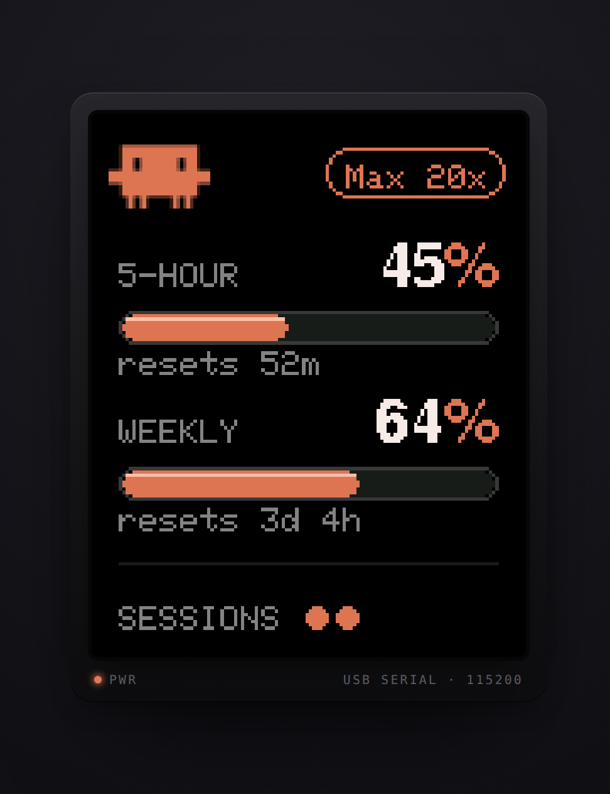

# claude-hud

A USB hardware display for Claude Code usage and session activity. A small Go
statusline tool sends usage data to a microcontroller over serial. The reference
firmware runs on an ESP8266 with a 128×160 ST7735 TFT.

[](https://github.com/danielhadian/claude-hud/actions/workflows/ci.yml)
[](LICENSE)

<p align="center">
  
</p>

[Try the browser simulator](https://danielhadian.github.io/claude-hud/simulator.html)
for a preview of the reference display.

The display shows:

- Five-hour and weekly usage percentages, with reset countdowns.
- A subscription tier label you configure during installation.
- One dot per session: filled and pulsing for busy, hollow for idle.

The host reads Claude Code's statusline payload. It does not read credentials,
call an API, or require Wi-Fi. Usage data becomes available after a session's
first API response on supported subscription plans. Without it, the terminal
statusline shows `usage —`.

## How it works

```text
Claude Code → statusline JSON → claude-usage → local socket → port holder
                                   ↓                            ↓
                            terminal statusline             USB display
```

Opening a serial port resets many development boards. The statusline therefore
starts a detached port holder on demand, rather than opening the port on every
update. The holder exits after five minutes without data or when a write fails.
No service manager is required. The statusline continues to work without a device.

The host and device communicate through a small [serial protocol](docs/PROTOCOL.md).
You can use the reference firmware or implement the protocol on another device.

## Reference hardware

- ESP8266 NodeMcu-style board with a USB-UART bridge.
- 1.8-inch ST7735 TFT, 128×160 pixels.
- Eight jumper wires and a USB data cable.

| Display | NodeMcu | Purpose |
|---|---|---|
| RST | D4 | Reset |
| CS | D8 | Chip select |
| D/C | D3 | Data/command |
| DIN | D7 | SPI MOSI |
| CLK | D5 | SPI clock |
| VCC | **Vin (5 V)** | Power on the reference module |
| BL | 3V3 | Backlight |
| GND | GND | Ground |

> **Check your module's power requirements.** The reference blue ST7735+SD
> module has an onboard regulator and needs **5 V at VCC**. Feeding it 3.3 V
> can leave the backlight dark. Other modules may require different wiring.

See [hardware notes](docs/HARDWARE.md) for module identification, wiring details,
and measured display performance.

## Setup

### 1. Build and flash the reference firmware

Install [Arduino CLI](https://arduino.github.io/arduino-cli/), then run from the
repository root:

```sh
cd firmware
make deps
make usage
```

`make deps` downloads the ESP8266 core and Adafruit display libraries.
`make usage` builds the firmware and flashes the first detected USB serial port.
Specify the port when multiple devices are connected:

```sh
make usage PORT=/dev/ttyUSB1
```

On Windows, use WSL2 with USB passthrough or run the Makefile's Arduino CLI
commands manually with a port such as `COM3`.

### 2. Build and register the host tool

Install [Go](https://go.dev/dl/) **1.25 or later**. From the repository root:

```sh
cd tools/claude-usage
go build -o claude-usage .
./claude-usage --install "Pro"
```

On Windows, build `claude-usage.exe`. Replace `Pro` with your tier label, such as
`Max 5x` or `Max 20x`. An installation without a label preserves an existing
label, or defaults to `Max 20x` on first use.

The installer merges a `statusLine` entry into Claude Code's `settings.json`
and saves the display configuration. It honors `CLAUDE_CONFIG_DIR`; otherwise
it uses `~/.claude`. Keep the binary at its registered location. If you move it,
run `--install` again; replacing an old registration may require `--force`.

An existing custom statusline is preserved, including wrappers that invoke
`claude-usage`. To replace one deliberately:

```sh
./claude-usage --install --force "Pro"
```

Open or continue a Claude Code session. The display normally updates within
about ten seconds. Disconnecting the hardware does not interrupt Claude Code.

## Configuration

The host configuration is `claude-usage/config.json` under the OS configuration
directory:

| System | Default location |
|---|---|
| Linux | `~/.config/claude-usage/` (honors `XDG_CONFIG_HOME`) |
| macOS | `~/Library/Application Support/claude-usage/` |
| Windows | `%AppData%\claude-usage\` |

```json
{
  "tier": "Pro",
  "port": "auto",
  "baud": 115200
}
```

- `tier`: display label. The reference panel uses up to 12 printable ASCII
  characters; protocol separators and control characters are replaced with spaces.
- `port`: `auto` or an explicit device path. Automatic detection finds USB serial
  devices on Linux/macOS and prefers common USB-UART bridges on Windows.
- `baud`: serial speed; it must match your device firmware.

Changes to `port` or `baud` take effect when the holder next starts. Close the
holder before flashing from outside the Makefile; `make usage` handles this for you.

## Data and accuracy

Usage comes from each session's most recent statusline payload, so it can lag
behind usage shown on claude.ai. The tool rounds the reported percentage; it
cannot recover precision or activity absent from the payload. Across sessions,
it keeps the highest reported usage for each reset window and rejects snapshots
from older windows.

Session activity uses Claude Code's local session registry, an undocumented
interface. When that source is unavailable or unrecognized, the host estimates
activity from recent statusline calls and cost changes. This fallback can miss
idle sessions and does not reliably indicate work in progress. The display
clears session activity after two minutes without an update.

The device counts reset times down locally between updates. After a reconnect,
the host replays cached usage with elapsed time subtracted from the countdowns.
Stale cached session activity is cleared.

## Other hardware

For another ST7735 variant, adjust pins, initialization, rotation, and display
settings in [`Panel.h`](firmware/lib/Panel/src/Panel.h). The reference layout is
tuned for a portrait display of at least 128×160 pixels; changing the dimensions
alone does not redesign it.

Using another Adafruit display driver requires adapting `Panel.h` and
`Panel.cpp`, including the SPI fast paths. For another MCU or display stack,
implement the [wire protocol](docs/PROTOCOL.md); the host tool needs no changes.

## Troubleshooting

| Problem | Check |
|---|---|
| Backlight flashes, then goes dark | Confirm your module's VCC requirement; the reference blue module needs 5 V. |
| Serial port permission denied on Linux | Check device ownership and your distribution's serial-port group, commonly `dialout`. Group changes require a new login. |
| Port busy during flashing | Stop the port holder, or flash through `make usage`. |
| Display waits for data | Confirm the statusline registration, subscription support, and that Claude Code has received an API response. |
| Wrong serial device selected | Set `port` explicitly in `config.json`; pass `PORT=...` when flashing. |
| Display upside down | Adjust `PANEL_ROTATION` in `Panel.h` and reflash. |
| Usage appears stale | Check the terminal statusline. Browser usage only reaches the display when a Claude Code session reports an updated snapshot. |

Use `make monitor` in `firmware/` to inspect serial debug output while the holder
is stopped.

## Development

Host tests use temporary directories and fake serial sinks; no hardware or
Claude credentials are needed:

```sh
cd tools/claude-usage
test -z "$(gofmt -l .)"
go vet ./...
go test ./... -race -count=1
```

Compile all four reference sketches without flashing:

```sh
cd firmware
make build-all
```

CI runs these checks, cross-compiles the host for Linux and macOS (amd64/arm64)
and Windows (amd64), and vets Windows-specific code. Windows behavior is
cross-compiled in CI; it has less physical-device testing than Linux/macOS.

`make selftest` and `make probe` flash diagnostic sketches. Physical hardware
is required to validate serial behavior, wiring, and the displayed image.

| Path | Contents |
|---|---|
| `tools/claude-usage/` | Go statusline tool and port holder |
| `firmware/usage_display/` | Reference usage display |
| `firmware/lib/Panel/` | Display driver and hardware settings |
| `firmware/examples/` | Diagnostic and demo sketches |
| `firmware/scripts/` | Bitmap generation, layout previews, and hardware probes |
| `docs/PROTOCOL.md` | Device protocol |
| `docs/HARDWARE.md` | Reference hardware notes |
| `docs/simulator.html` | Standalone browser simulator |
| `docs/design/` | Historical design rationale and implementation plan |

## License

[MIT](LICENSE)
